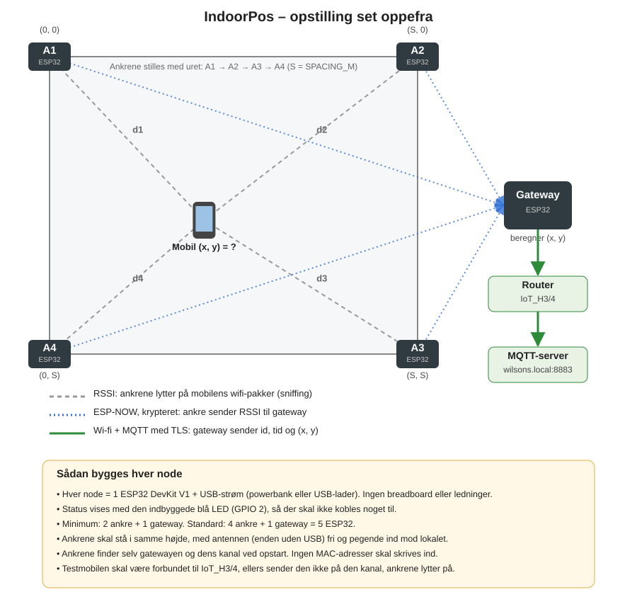

# IndoorPos

Positionsbestemmelse af mobiler uden GPS – IoT II, TEC.
ESP32-ankre måler signalstyrken (RSSI) fra mobilers wi-fi. En gateway-ESP32 regner positionen ud og sender **id, tid og (x, y)** til MQTT.
Virker med **2 ankre** (position på en linje) og **3 eller flere** (position i planet): trekant, firkant, femkant, sekskant osv.



## Arkitektur
| Del | Program | Opgave |
|---|---|---|
| Start | `src/main.cpp` | Samme program på alle boards. Vælger rollen ud fra det, der er skrevet i Serial Monitor |
| Ankre | `src/anchor/` | Sniffer wi-fi-pakker, beregner gennemsnitlig RSSI pr. enhed, sender til gatewayen med ESP-NOW |
| Gateway | `src/gateway/` | Finder ankrene, modtager RSSI, beregner (x, y), sender til MQTT med TLS |
| Matematik | `lib/positioning/` | RSSI → afstand, trilateration og position på en linje. Uden Arduino, så den kan testes og genbruges |
| Beskeder | `include/protocol.h` | Hello fra gateway, hello fra anker, måling |

**Dataflow:** mobil → (wi-fi-pakke) → anker → (ESP-NOW) → gateway → (MQTT, TLS) → wilsons.local → database.

**Automatisk forbindelse:** Gatewayen siger "her er jeg" to gange i sekundet. Et anker prøver kanal 1-13, til det hører sin gateway, og svarer med sit nummer og sin position. Derfor skal hverken MAC-adresser eller kanal skrives ind nogen steder. Hver gruppe får sit eget nummer ud fra `MQTT_USER`, så flere hold kan køre samme program i samme lokale uden at blande boards.

**Hvilke enheder spores:** kun enheder, der er forbundet til wi-fi og sender data til routeren (fx en mobil på `IoT_H3/4`). Mobiler, der kun leder efter netværk, bruger en tilfældig MAC, som skifter hele tiden, og ville give falske enheder.

## Hardware
- 1 ESP32 DevKit V1 som gateway og 2 eller flere som ankre.
- USB-strøm til hver (powerbank eller lader). **Ingen ledninger eller breadboard.**
- Den indbyggede blå LED (GPIO 2) viser status.

| LED | Anker | Gateway |
|---|---|---|
| Langsomt blink | Venter på en rolle | Venter på en rolle |
| Dobbeltblink | Leder efter gatewayen | – |
| Kort blink | Sender måling | – |
| Tændt | – | Forbundet til MQTT |

## Opsætning
1. Kopiér `include/secrets_example.h` til `include/secrets.h`, og udfyld den.
2. Upload til alle boards (samme program).
3. Sæt hvert board til computeren, åbn Serial Monitor, skriv, og tryk Enter:
   - `g` på ét board → gateway
   - `1`, `2`, `3` … på de andre → ankrenes numre
4. Skriv opstillingen i **gatewayens** Serial Monitor (standard er 4 ankre, 2 m):
   - `anchors 4` → antal ankre
   - `spacing 2` → meter mellem to naboankre
   - `list` → vis opstillingen, og hvilke ankre der er med
5. Stil ankrene op som vist nedenfor, og tænd alle boards. Færdig.

Alt gemmes i boardets flash, så det kun skal skrives én gang. Ingen ny upload, når opstillingen ændres.

**Sådan stilles ankrene:** altid **med uret** rundt, set oppefra. A1 øverst til venstre, A2 til højre for den, og så videre rundt. `spacing` er afstanden mellem to naboer.
```
2 ankre:  A1 ── A2

3 ankre:  A1 ── A2        4 ankre:  A1 ── A2        5, 6, 7 … ankre:
            \  /                    │      │        samme idé, femkant,
             A3                     A4 ── A3        sekskant osv.
```
- Gatewayen skriver `Anchor A1 at (0.00, 0.00) joined` for hvert anker.
- Testmobilen skal være forbundet til `IoT_H3/4`.
- **Skæv opstilling?** Skriv nummer og position selv, fx `3 1.5 2` (x og y i meter).
- **Anker slukket?** Gatewayen fjerner det efter 30 sekunder (`Anchor A3 left`) og regner videre med resten. Tændes det igen, kommer det selv med.
- **Skift rolle:** skriv en ny kommando, eller `reset` for at starte forfra (glemmer også opstillingen).

## Kalibrering
Afstanden beregnes med `d = 10^((RSSI_AT_1M − RSSI) / (10 · n))`.
1. Sæt `PUBLISH_RAW = true`, og upload gatewayen. Rå målinger kommer nu på `elever/<bruger>/rssi`.
2. Hold mobilen 1 m fra et anker. Gennemsnittet af RSSI er `RSSI_AT_1M`.
3. Gentag ved 2, 3 og 4 m. Regn `n = (RSSI_AT_1M − RSSI) / (10 · log10(d))` ud, og tag gennemsnittet. Det er `PATH_LOSS_EXPONENT`.
4. Skriv tallene i `config.h`, og sæt `PUBLISH_RAW = false`.

## Data (MQTT)
Topic: `elever/<bruger>/position` på `wilsons.local:8883` (TLS + login).
```json
{"id":"3f2a9c1b7d4e8a60","time":"2026-11-26 10:15:02 CET","ts":1795680902,"x":1.85,"y":2.40,"anchors":4}
```
| Felt | Betyder |
|---|---|
| `id` | Anonymt id: hash af MAC-adressen med hemmeligt salt |
| `time` | Dansk tid, til mennesker |
| `ts` | Unix-tid, til beregninger (fx antal pr. time) |
| `x`, `y` | Position i meter, i samme koordinater som ankrenes positioner |
| `anchors` | Antal ankre bag beregningen |

**Krav til datalagringen:** en MQTT-broker med TLS på port 8883, et login med skriveret til `elever/<bruger>/#` og en subscriber, der gemmer hver JSON-linje (fx lærerens Mosquitto + MongoDB). Felterne er flade, så der kan grupperes direkte på `ts` (pr. time) og `x`/`y` (heatmap).

## Indstillinger (`include/config.h`)
| Navn | Standard | Betyder |
|---|---|---|
| `RSSI_AT_1M` | −45 | Kalibreres |
| `PATH_LOSS_EXPONENT` | 2.5 | Kalibreres |
| `RSSI_MIN` | −90 | Svagere pakker ignoreres |
| `DEFAULT_ANCHORS` | 4 | Antal ankre, indtil der er skrevet `anchors <n>` på gatewayen |
| `DEFAULT_SPACING_M` | 2.0 | Meter mellem naboankre, indtil der er skrevet `spacing <m>` |
| `LOST_ANCHOR_MS` | 30000 | Et anker, der ikke er hørt så længe, fjernes |
| `MIN_ANCHORS` | 2 | Ankre der skal til for en position |
| `MAX_ANCHORS` | 32 | Ankre gatewayen kan holde styr på |
| `ESPNOW_ENCRYPT` | true | Krypteret ESP-NOW. Højst 7 ankre (ESP32-grænse, tjekkes ved kompilering). Sæt `false` for flere |
| `WINDOW_MS` | 2000 | Gennemsnit og beregning hvert 2. sekund |
| `STALE_MS` | 6000 | Ældre målinger bruges ikke |
| `FORGET_MS` | 60000 | Enheder glemmes efter 1 minut |
| `PUBLISH_RAW` | true | Send rå RSSI (kun til kalibrering) |

## Fejlfinding
| Problem | Løsning |
|---|---|
| Ingen positioner | Mobilen sender næsten intet, når skærmen er slukket. Hold skærmen tændt og afspil fx en video under test |
| Anker dobbeltblinker hele tiden | Den hører ikke gatewayen. Tjek at gatewayen kører og har wi-fi, og at `secrets.h` er ens på alle boards (samme `MQTT_USER` og `ESPNOW_PMK`) |
| `A3 moved to a new board` gentages | To boards har samme nummer. Giv det ene et nyt nummer i Serial Monitor |
| `Warning: A5 is higher than the number of anchors` | Ankrets nummer er større end antallet. Skriv `anchors 5` på gatewayen |
| `Anchors must be 2-7` | Grænsen for krypteret ESP-NOW. Sæt `ESPNOW_ENCRYPT = false` for flere ankre |
| `no room for more encrypted anchors` | For mange krypterede ankre. Sæt `ESPNOW_ENCRYPT = false` |
| `MQTT error 4/5` | Forkert MQTT-login |
| Positionen hopper meget | Normalt for RSSI. Kalibrér igen, og hold ankrene i samme højde med fri antenne |

## Udskiftning og udbygning
- **Flere eller færre ankre:** skriv fx `anchors 5` på gatewayen, og giv det nye anker et nummer. Ingen upload.
- **Udskift et anker:** giv det nye board samme nummer. Gatewayen glemmer selv det gamle.
- **Andet signal end wi-fi** (fx BLE): skift kun snifferen i `src/anchor/`. Beskederne og gatewayen er uændrede.
- **Anden beregning** (fx vægtet centroid eller Kalman-filter): skift `lib/positioning/`. Testene viser, om den stadig virker.
- **ESP-MESH i stedet for ESP-NOW:** kun afsendelsen i ankeret og modtagelsen i gatewayen skal skiftes.
- **Anden server:** `connectMqtt()` og `publish` i gatewayen er det eneste, der kender MQTT.

## Test
Matematikken testes på computeren med 2, 3, 4, 6 og 9 ankre:
```
g++ -std=c++17 -I lib/positioning hosttest/test_positioning.cpp lib/positioning/positioning.cpp -o hosttest/run
./hosttest/run
```

## Persondata
Se `docs/portfolio.md`. Kort: den rå MAC-adresse forlader aldrig ankeret, den ligger kun i RAM i 2 sekunder, og gatewayen glemmer enheder efter 1 minut.
