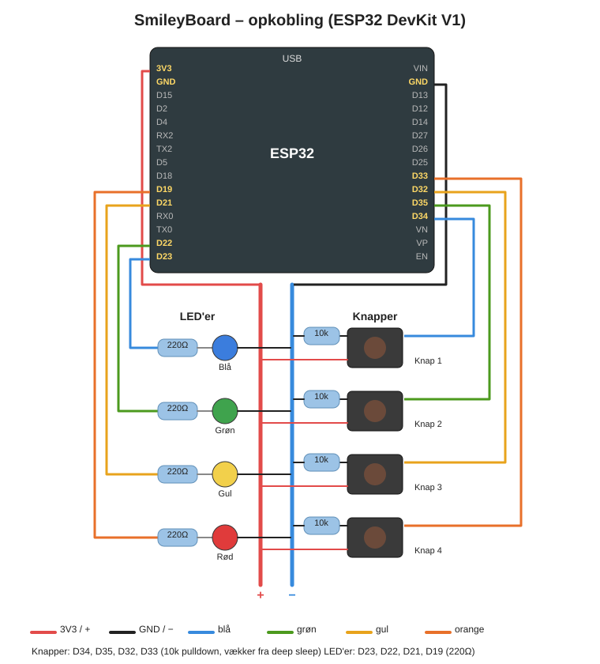

# Smiley feedback panel

IoT II · H4 · TEC
Marcus og (makker)

ESP32 · MQTT · TLS · Deep sleep

<!--
Vi har bygget et smiley-panel som dem i banken og supermarkedet.
Det sender et tryk sikkert over wi-fi og bruger næsten ingen strøm, når ingen trykker.
-->

---

## Agenda

1. Idé og krav
2. Hardware og pins
3. Programmet og deep sleep
4. Tid, MQTT og sikkerhed
5. Knaplogik og test
6. Målinger og analyse
7. Proces og forbedringer
8. Demo

<!--
Vi går fra hardware til software, og slutter med hvordan vi har testet og arbejdet.
-->

---

## Idéen

- 4 knapper: meget glad → meget sur
- Et tryk sendes over wi-fi til en server
- Skal kunne køre på batteri i lang tid

**Udfordringen:** et tryk skal frem hurtigt og sikkert, men enheden skal sove det meste af tiden.

<!--
Selve knapperne er nemme. Det svære er at kombinere netværk, kryptering og strømbesparelse.
Wi-fi bruger meget strøm, så den kan ikke være tændt hele tiden.
-->

---

## Krav → vores løsning

| Krav | Løsning |
|---|---|
| 4 knapper + LED | Knap på RTC-pin, LED med 220Ω |
| Debounce | 50 ms, alle knapper skal være sluppet |
| Wi-fi + NTP + tidszone | NTP ved hver opvågning, CET/CEST |
| Værdi + timestamp via MQTT | JSON med `button`, `mood`, `time`, `ts` |
| Login + TLS | Port 8883, CA-certifikat, `secrets.h` |
| Deep sleep | Sover efter 10 s, vågner på knap eller hver time |

<!--
Her er alle produktkravene, og hvordan vi har løst dem. Vi går i dybden med hvert punkt.
Låsen på 7 sekunder er valgfri hos os (LOCK_WHILE_LED), fordi læreren gerne ville kunne trykke frit.
-->

---

## Hardware



| Del | Pins | Ekstra |
|---|---|---|
| 4 knapper | D34, D35, D32, D33 | 10k pulldown til GND |
| 4 LED'er | D23, D22, D21, D19 | 220Ω i serie |

<!--
Knapperne går fra 3V3 til en pin. En 10k modstand trækker pin'en ned til 0, når ingen trykker.
LED'erne har en 220 ohm modstand, så strømmen holdes nede og LED'en ikke brænder af.
-->

---

## Hvorfor netop de pins?

- Kun **RTC-pins** kan vække ESP32 fra deep sleep → D32–D35
- D34/D35 har **ingen indbygget pulldown** → ekstern 10k
- Uden pulldown "svæver" pin'en og kan vække enheden tilfældigt
- Vi undgår **strapping-pins** (D0, D2, D5, D12, D15), som påvirker opstart
- Vi undgår **TX0/RX0**, som bruges af USB

<!--
Vi startede med andre pins, men fandt ud af, at ikke alle kan vække chippen.
Det var en vigtig læring: pins er ikke ens.
Modstanden gør, at enheden kun vågner, når nogen faktisk trykker.
-->

---

## Programmets flow

1. **Sover** (deep sleep)
2. **Vågner** på knaptryk eller timer (hver time)
3. Tænder LED'en **med det samme**
4. Wi-fi → tid (NTP) → MQTT med TLS
5. Sender beskeden
6. Vågen i 10 s og lytter efter flere tryk
7. **Sover** igen

<!--
Efter deep sleep starter programmet forfra i setup(). Derfor sker det meste der.
LED'en tændes før netværket, så brugeren ser et svar med det samme,
selvom det tager 1-3 sekunder at få forbindelse.
-->

---

## Deep sleep – hvordan

- CPU, wi-fi og RAM slukkes
- Kun **RTC** er tændt: et ur og en "vækker"
- Vågner på:
  - **ext1**: en af de 4 knapper bliver HIGH
  - **timer**: hver time (`SLEEP_S = 3600`)
- Uret overlever søvnen, så tiden er klar med det samme

<!--
ext1 med ANY_HIGH betyder: vågn, hvis bare én af knapperne bliver høj.
Det er derfor, knapperne går til 3V3 og ikke til GND.
Efter opvågning læser vi, hvilken knap der vækkede os, så det tryk ikke går tabt.
-->

---

## Deep sleep – afvejningen

| Valg | For kort | For lang |
|---|---|---|
| Vågen uden tryk (`AWAKE_MS` = 10 s) | Ny opstart ved næste tryk koster 1–3 s og strøm | Wi-fi bruger strøm uden grund |
| Rutine-opvågning (`SLEEP_S` = 1 t) | Unødig strøm til wi-fi | Uret kan drive, ingen livstegn |

**Gennemsnitlig strøm:**
I = (I_vågen · t_vågen + I_sover · t_sover) / periode

<!--
Det er den vigtigste analyse i opgaven.
Hvis vi sover for hurtigt, skal vi forbinde igen ved næste tryk, og det koster mere strøm end at vente lidt.
Hvis vi er vågne for længe, brænder wi-fi strøm af.
Formlen viser, at strømmen i søvn betyder mest, fordi den varer længst tid.
-->

---

## Tid

- Hentes med **NTP** ved hver opvågning
- Tidszone: `CET-1CEST,M3.5.0,M10.5.0/3`
- Skifter selv mellem vintertid (CET) og sommertid (CEST)
- Tiden **skal** kendes før TLS: certifikatet har en gyldighedsperiode

<!--
Tidszone-strengen betyder: CET er UTC+1, sommertid starter sidste søndag i marts
og slutter sidste søndag i oktober kl. 3.
Uden korrekt tid kan ESP32 ikke tjekke, om certifikatet er gyldigt, og så fejler TLS.
-->

---

## MQTT

- Publish/subscribe: enheden sender til en **broker**, ikke direkte til modtageren
- Broker: `wilsons.local` (Mosquitto)
- Topic: `elever/marcus/smiley`
- Alle, der abonnerer på topic'et, får beskeden

<!--
Fordelen er, at enheden ikke skal kende modtagerne.
En dashboard-app eller en database kan bare abonnere på topic'et.
Vi må kun skrive i elever/marcus/ og test/, det styrer brokeren.
-->

---

## Beskeden

```json
{"button":1,"mood":"very_happy","time":"2026-11-25 09:47:35 CET","ts":1795596455}
```

| Felt | Hvorfor |
|---|---|
| `button` | Hvilken knap (1–4) |
| `mood` | Hvad knappen betyder |
| `time` | Dansk tid, kan læses af mennesker |
| `ts` | Unix-tid, nem at regne med for maskiner |

<!--
Vi sender både time og ts. time er til mennesker, ts er til programmer,
fx hvis man vil tælle tryk pr. time.
JSON gør det nemt at tilføje felter senere uden at ødelægge noget.
-->

---

## Sikkerhed

- **TLS** på port 8883: alt er krypteret
- **CA-certifikat**: beviser, at serveren er den rigtige
- **Brugernavn + kode**: beviser, at det er os
- Koder ligger i `secrets.h`, som er i `.gitignore`
- Vi bruger **ikke** `setInsecure()`

<!--
Certifikatet og koden gør to forskellige ting:
certifikatet beskytter os mod en falsk server, koden beskytter serveren mod falske enheder.
setInsecure ville slå tjekket af certifikatet fra, og så var krypteringen meget mindre værd.
-->

---

## Knaplogik

- **Debounce 50 ms**: en knap der preller giver ét tryk
- **Holdt knap**: kun én besked
- **To knapper samtidig**: kun én tæller
- **Lås** (`LOCK_WHILE_LED`): kan slås til, så man ikke kan spamme
- Sover **ikke**, mens en knap holdes (ellers vågner den straks igen)

<!--
En mekanisk knap hopper mange gange på få millisekunder.
Vores regel: et nyt tryk tæller først, når alle knapper har været sluppet i 50 ms.
Det løser både prel, holdte knapper og flere knapper på én gang med én regel.
-->

---

## Test

**Selvtest** ved hver opstart
LED'erne blinker, knapperne tjekkes. Fejl → alle LED'er blinker.

**Simuleringstest** (`simtest/`)
- Kører den rigtige kode på computeren med falsk tid
- 16 scenarier: spam, prel, holdte knapper, søvn, JSON, dansk tid
- Fandt **2 fejl**, som vi rettede

<!--
Selvtesten finder hardwarefejl, fx en manglende modstand.
Simuleringstesten finder logikfejl uden at vi skal trykke 100 gange i hånden.
Den fandt fx, at et tryk lige efter en timer-opvågning blev ignoreret.
Vi tjekkede også, at testen fejler, hvis vi fjerner debounce. Så ved vi, at testen virker.
-->

---

## Målinger

| Måling | Resultat |
|---|---|
| Tid fra tryk til besked | ___ s |
| Strøm, vågen | ___ mA |
| Strøm, deep sleep | ___ mA |
| Gennemsnitlig strøm | ___ mA |
| Batteritid med ___ mAh | ___ dage |

**Batteritid** = kapacitet (mAh) / gennemsnitlig strøm (mA)

<!--
Her fortæller vi, hvad vi har målt, og hvad det betyder for batteritiden.
Et udviklingsboard bruger mere strøm i søvn end selve chippen, fordi USB-chip og spændingsregulator stadig er tændt.
Det er en vigtig pointe: i et rigtigt produkt ville man bruge en bare ESP32 uden USB-chip.
-->

---

## Proces

- **Git** fra dag ét, pushet til GitHub, læreren har adgang
- **Logbog** committet dagligt af begge
- **Portfolio**: idé → skitse → løsning
- Små skridt: hardware → wi-fi → MQTT → TLS → deep sleep → test

<!--
Vi byggede i små trin og testede hvert trin, før vi gik videre.
Det gjorde det nemt at finde fejl, fx da wi-fi virkede, men tiden ikke kunne hentes.
-->

---

## Hvad vi ville forbedre

- Måle og optimere strømmen på batteri
- Gemme tryk i RTC-hukommelse, hvis wi-fi er nede, og sende dem senere
- QoS 1, så brokeren kvitterer for hver besked
- Bare ESP32-modul uden USB-chip i et rigtigt produkt

<!--
Lige nu går et tryk tabt, hvis wi-fi er nede. RTC-hukommelsen overlever deep sleep,
så vi kunne gemme trykkene der og sende dem næste gang.
Det viser, at vi kender begrænsningerne i vores løsning.
-->

---

# Demo

1. Tryk på en knap → LED lyser
2. Serial Monitor: `Connected` og JSON
3. Weblog: beskeden er nået frem
4. Vent 10 s → `Sleeping...`

**Spørgsmål?**

<!--
Vis Serial Monitor og weblog'en side om side.
Tryk på en knap, mens den sover, så man ser opvågningen.
-->
